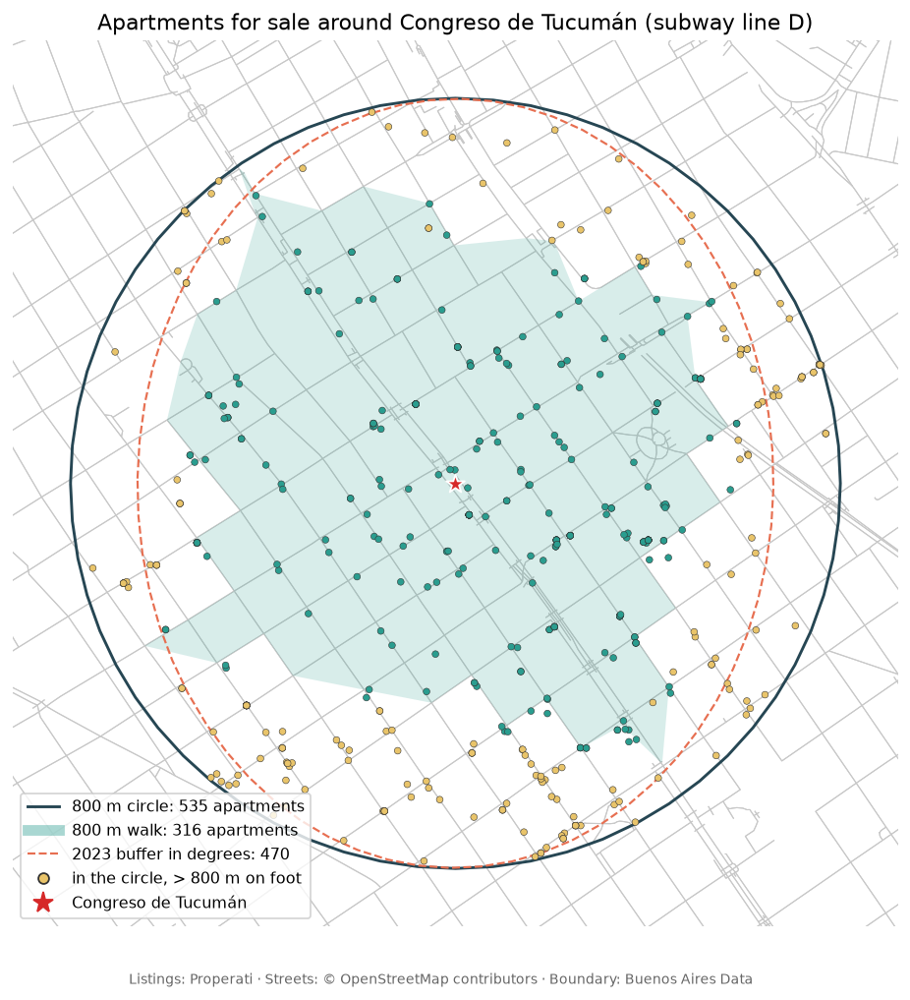
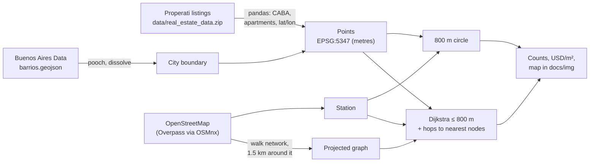

# analytics

[](requirements.txt)
[](LICENSE)

**Start here →** [](https://colab.research.google.com/github/oechenique/analytics/blob/main/notebooks/01_caba_subway_apartments.ipynb) · [🇦🇷 Español](README.es.md)

**Real-estate geoanalytics in Buenos Aires: how many apartments for sale are within 800 m of a subway station, as the crow flies and on foot. Properati listings, OpenStreetMap streets, GeoPandas and OSMnx, buffers in metres.**



One notebook, runnable in Colab or locally, rewritten in 2026 from the 2023 version (kept in [`legacy/`](legacy/) with three unfinished drafts about Japan).

## Notebook

| # | Notebook | What it does | Runtime* |
|---|---|---|---|
| 01 | [Apartments near a subway station](notebooks/01_caba_subway_apartments.ipynb) [](https://colab.research.google.com/github/oechenique/analytics/blob/main/notebooks/01_caba_subway_apartments.ipynb) | Listings clipped to the city, Congreso de Tucumán station from OSM, 800 m circle vs. 800 m along the walking network, counts and median USD/m² | ~3 min first run, ~15 s cached |

\* Measured on a laptop over home broadband; most of it is the Overpass download.

## How it works



Everything is projected to POSGAR 2007 / Argentina 5 (EPSG:5347) before measuring, so buffers and distances are in metres. Walking distance is the shortest path along OSM streets from the node nearest to the station to the node nearest to each apartment, plus the two straight hops to those nodes.

## What it shows

- **535 apartments are in the 800 m circle, but only 316 are within 800 m on foot**: 41 % of the circle is further than that when you walk the streets. The area within an 800 m walk is ~95 ha against 201 ha for the circle; the median walk is 1.39× the straight-line distance ([notebook 01](notebooks/01_caba_subway_apartments.ipynb)).
- **The 2023 answer used a buffer in degrees** (`0.0072°`), which at 34.6°S is an ellipse of ~800 × 660 m: 470 apartments, neither the circle nor the walk.
- **Prices hold across the three areas**: median 2,694–2,744 USD/m². The 2023 heatmap plotted `price_per_m2`, which mixes pesos and dollars; this version uses `price_usd_per_m2`.
- The file has 121,220 sale listings, 19,418 of them apartments with coordinates inside the city boundary.

## Decisions and what I learned

- **Project before buffering.** A degree of longitude at Buenos Aires is ~18 % shorter than a degree of latitude; a buffer in EPSG:4326 is an ellipse and GeoPandas warns about it. EPSG:5347 is the official projected CRS for the city's longitude.
- **Network distance instead of an isochrone polygon.** Each apartment is measured to its own nearest node, so the count does not depend on how the walkable area is drawn; the shaded polygon on the map is only a concave hull for display.
- **Only the network around the station.** 1.5 km around Congreso de Tucumán (2,384 nodes) covers everything reachable in 800 m and downloads in seconds; the whole city's walking network is not needed.
- **City boundary from Buenos Aires Data.** The 2023 version read it from the INDEC WFS, which did not respond on 2026-10-27; the city's own barrios GeoJSON is enough to clip the listings.

<details>
<summary><b>Limits and what I'd do next</b></summary>

- Listings are asking prices, not sale prices, and the file has no listing dates.
- Many listings share approximate coordinates (geocoded to a street or block), so counts are approximate near the edges.
- OSM's walking network includes some paths through private or closed areas and misses others; 800 m is also a rule of thumb, not a measured walking threshold.
- Next: repeat for every subway station and compare price per m² inside the walking area vs. just outside it.

</details>

<details>
<summary><b>Stack</b></summary>

| Layer | Tools |
|---|---|
| Vector data | `geopandas`, `shapely`, `pyproj` (EPSG:5347) |
| OpenStreetMap | `osmnx` (Overpass, walking graph), `networkx` (Dijkstra), `scipy` (nearest nodes) |
| Tables | `pandas`, `numpy` |
| Data management | `pooch` (cached download) |
| Figures | `matplotlib` |

</details>

<details>
<summary><b>Repository layout</b></summary>

| Path | Contents |
|---|---|
| `notebooks/` | The notebook, with its outputs |
| `data/real_estate_data.zip` | Properati listings used by the notebook (other files in `data/` are downloaded at run time and ignored) |
| `docs/img/` | Figure exported by the notebook |
| `legacy/` | The original 2023 notebook and three unfinished Japan drafts, untouched, with a note |
| `Notebook/` | Stubs at the old paths, so links shared before 2026 still lead somewhere |
| `requirements.txt` | Pinned environment for running locally |

</details>

## Run it

**Colab:** click a badge above. The first cell installs `osmnx` and `pooch`, and the listings zip is downloaded from this repo.

**Locally** (tested with Python 3.12.10 on Windows 11):

```bash
git clone https://github.com/oechenique/analytics.git
cd analytics
python -m venv .venv
.venv/Scripts/python -m pip install -r requirements.txt   # Linux/macOS: .venv/bin/python
.venv/Scripts/python -m jupyter lab notebooks/
```

No credentials are needed.

<details>
<summary><b>Licenses and attribution</b></summary>

- **Code:** [MIT](LICENSE).
- **Listings:** sale listings published by [Properati](https://www.properati.com.ar/) (the file includes each listing's `properati_url`). The license of this export is not stated in the file; it is credited here as the source.
- **Streets and stations:** © OpenStreetMap contributors, [ODbL](https://www.openstreetmap.org/copyright).
- **City boundary:** barrios of the City of Buenos Aires, [Buenos Aires Data](https://data.buenosaires.gob.ar/).

</details>
